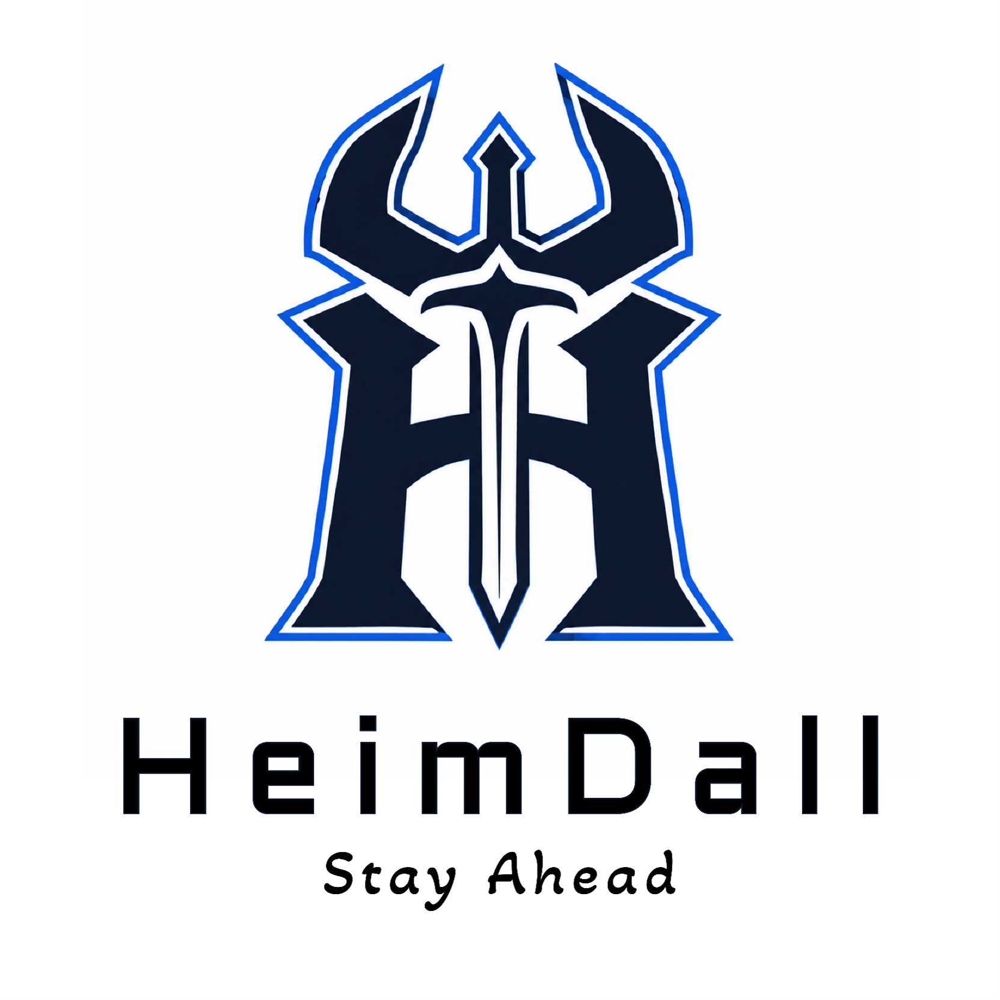
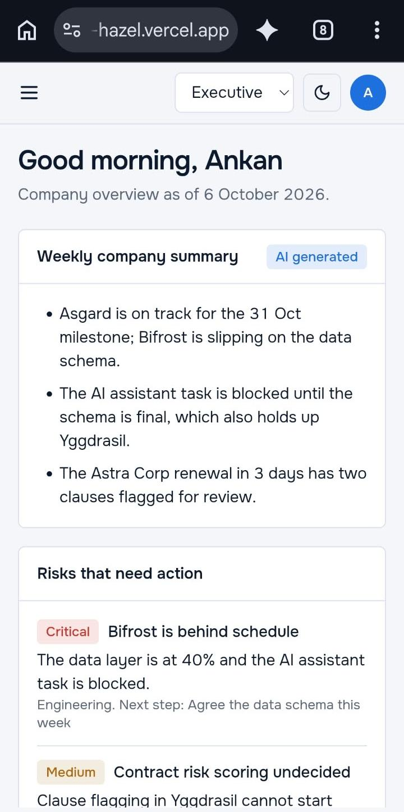
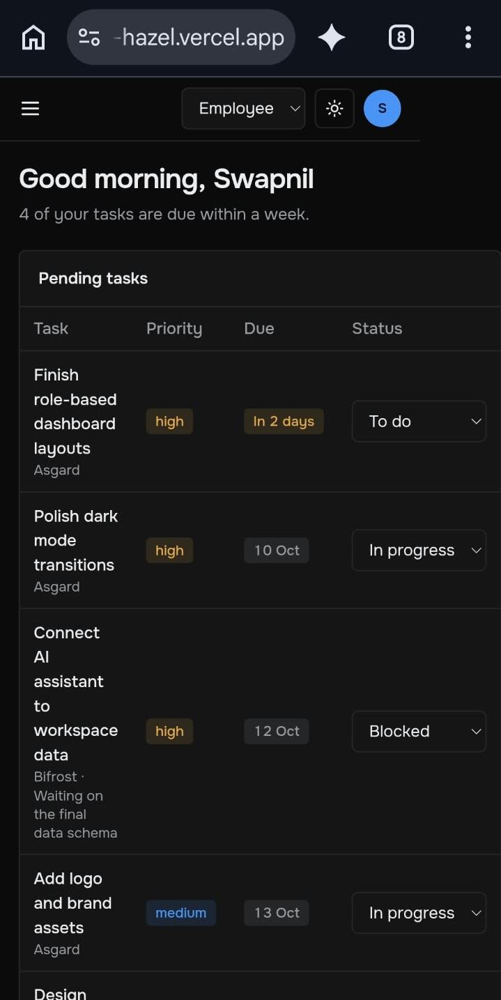
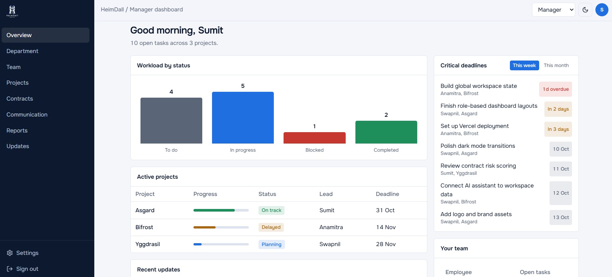
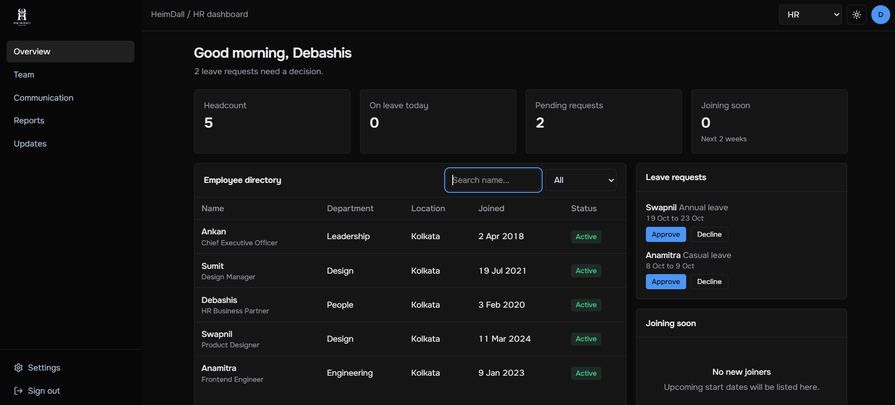

  <p align="center">  </p>

# HeimDall

> A company management platform that helps teams keep people, projects, documents, contracts, and obligations organized in one place.

---

## The Idea

Companies often manage important information across spreadsheets, chat messages, emails, cloud folders, and disconnected tools. This makes it difficult to know what needs attention, who is responsible for it, and what obligations are approaching. **HeimDall** brings company operations into one centralized workspace for managing people, projects, tasks, documents, contracts, and obligations. Its core differentiator is contract intelligence, helping teams understand contracts, identify risks, extract obligations, and track what needs to be done.

---

| | |
|---|---|
| 🌐 **Live demo** | https://heim-dall-10.vercel.app/ |
|💻 Repository	|https://github.com/Paradoxankan/HeimDall |
---

## Previews

| | Light | Dark |
|---|---|---|
| **Mobile (375px)** |  |  |
| **Desktop (1280px)** |  |  |

---

## What It Does
 
Growing companies run on scattered tools: contracts live in PDFs, tasks in one app, leave requests in email, and nobody has a single view of what is at risk. HeimDall gives employees, managers, HR and executives one workspace, each with a dashboard built for their role. Its AI layer reads uploaded contracts, extracts the obligations and deadlines hidden in them, and turns those obligations into tracked tasks, so nothing that was promised gets forgotten.

**Four role-based dashboards**

- **Employee:** pending and ongoing tasks, project updates, active projects, and the Heimdall AI assistant.
- **Manager:** a workload status chart (To Do / In Progress / Blocked / Completed), team view with active task counts, critical deadlines, active projects, quick actions and an activity feed.
- **HR:** an employee directory with live, keystroke-by-keystroke search.
- **Executive:** organization-wide overview with a weekly AI company summary, overall risk score, key risks, contract alerts, revenue reports and items requiring attention.

---
 
## Features
 
- **Role-based dashboards**: separate Employee, Manager, HR and Executive views, enforced on the server, not just hidden in the UI.
- **Task management**: managers create and assign tasks; assignees update status (To do, In progress, Blocked, Done).
- **Leave management**: employees request leave and HR or executives approve or decline it.
- **Executive overview**: company health score, project progress, risks, revenue and contract alerts at a glance.
- **AI contract intelligence**: upload a contract (PDF or text) and the AI extracts a summary, obligations, owners and deadlines.
- **Contract-to-task automation**: one click turns extracted obligations into tasks in a "Contracts" project.
- **HeimDall AI assistant**: ask questions about overdue work, blocked tasks and upcoming obligations.
- **Secure sign-in**: Google and GitHub OAuth, with executive role bootstrapping via an allow-list.
- **Light and dark mode**, responsive layout.
---


## Documents

- 🚀 [Fullstack Application Guide](./heimdall-fullstack/README.md)
- 📋 [Testing & Verification Checklist](./heimdall-fullstack/docs/TESTING.md)
- 📡 [REST API Specification](./heimdall-fullstack/docs/API_SPEC.md)
- [Product Requirements](./HeimDall_PRD.md)
- [Architecture](./Architecture.md)
- [Roadmap](./HeimDall_Roadmap.md)
- [Requirements](./HeimDall_Requirements.md)
- [Sketch](./sketches)

---
 
## Architecture
 
```
Browser
  └── Next.js 15 on Vercel
        ├── /app            Pages + Server Components
        ├── /app/api        REST API routes (role-checked)
        ├── /components     Shell, dashboards, UI kit
        └── /lib            Prisma client, auth guard, client store, AI helpers
              └── Neon Postgres (via Prisma)
              └── Gemini API (contract extraction, assistant)
```
 
A signed-in user's role is read from the database on every API call. The client loads role-filtered workspace data from `/api/bootstrap` and sends changes (tasks, leave, roles) back through small REST routes. When a contract is uploaded, the server sends it to the AI model, validates the JSON it returns, stores the contract and its obligations, and creates tasks on request.
 
---

## Tech Stack
 
| Layer | Technology | Why |
|---|---|---|
| Framework | Next.js 15 (App Router) + React 19 | Full-stack in one codebase, server components |
| Database | Neon PostgreSQL + Prisma 6 | Typed queries, easy schema changes |
| Auth | Auth.js (next-auth v5) with Google + GitHub | Secure OAuth, no passwords to store |
| Styling | Tailwind CSS 4 | Fast, consistent, themeable |
| AI | Google Gemini API | Reads PDFs and returns structured JSON |
| Deployment | Vercel | Native Next.js hosting |
 
---
## Database Schema
 
```sql
-- Key tables (managed with Prisma)
 
users          (id, name, email, role[EMPLOYEE|MANAGER|HR|EXECUTIVE], title, dept, city, joined_at, on_leave)
accounts       (id, user_id → users.id, provider, provider_account_id, ...)   -- Auth.js
sessions       (id, session_token, user_id → users.id, expires)               -- Auth.js
projects       (id, name, sub, status, pct, team, lead, milestone, deadline)
tasks          (id, title, desc, priority, due, status[TODO|PROGRESS|BLOCKED|DONE],
                progress, reason, project_id → projects.id, assignee_id → users.id)
leave_requests (id, user_id → users.id, type, from, to, status[PENDING|APPROVED|DECLINED])
risks          (id, level, title, detail, dept, next)
contracts      (id, name, due, note, party, summary, file_name, created_at)
obligations    (id, contract_id → contracts.id, text, owner, kind, due, priority, task_id)
activity       (id, who, what, target, at)
```
 
---
## API Routes
 
| Method | Route | Auth |
|--------|-------|------|
| GET | `/api/bootstrap` | Signed in (data filtered by role) |
| POST | `/api/tasks` | Manager, Executive |
| PATCH | `/api/tasks/:id` | Assignee, Manager, Executive |
| DELETE | `/api/tasks/:id` | Manager, Executive |
| POST | `/api/leave` | Signed in |
| PATCH | `/api/leave/:id` | HR, Executive |
| PATCH | `/api/users/:id` | Executive |
| GET | `/api/contracts` | Manager, Executive |
| POST | `/api/contracts/analyze` | Manager, Executive |
| POST | `/api/contracts/:id/tasks` | Manager, Executive |
| DELETE | `/api/contracts/:id` | Manager, Executive |
 
---
## Getting Started
 
```bash
git clone https://github.com/YOUR_USERNAME/YOUR_REPO
cd YOUR_REPO
npm install
cp .env.example .env.local
# Edit .env.local
npx prisma db push
npm run db:seed   # optional demo data
npm run dev
```
---
 
## Environment Variables
 
| Variable | Description |
|---|---|
| `DATABASE_URL` | Pooled Postgres connection string (Neon) |
| `DATABASE_URL_UNPOOLED` | Direct connection string for migrations |
| `AUTH_SECRET` | Auth.js secret (`npx auth secret`) |
| `AUTH_GITHUB_ID` / `AUTH_GITHUB_SECRET` | GitHub OAuth app credentials |
| `AUTH_GOOGLE_ID` / `AUTH_GOOGLE_SECRET` | Google OAuth credentials |
| `ADMIN_EMAILS` | Comma-separated emails that become Executive on first sign-in |
| `AI_PROVIDER` | `gemini` |
| `AI_MODEL` | Model name used for extraction |
| `GEMINI_API_KEY` | **Server-only** Gemini API key (never prefix with `NEXT_PUBLIC_`) |
 
---
## Auth Flow
 
- Provider: Google and GitHub OAuth via Auth.js
- Sessions: JWT sessions, user records stored through the Prisma adapter
- Roles: new users start as Employee; emails in `ADMIN_EMAILS` become Executive on first sign-in, and Executives can change other users' roles
- Protected routes: unauthenticated visitors are redirected to the sign-in page, and every API route re-checks the user's role on the server
---

## What We Learnt

1. **What we built:** HeimDall, a high-fidelity enterprise workspace MVP with four distinct role-based dashboards (Employee, Manager, HR, Executive).
2. **Hardest challenge:** managing global state across four role-based dashboards while fighting browser caching, so the mocked JSON data stayed in sync with the UI.
3. **Proudest design decision:** the dynamic Manager Workload Chart, which recalculates in real time as task statuses change anywhere in the workspace.
4. **Proudest animation:** the Gemini-style mobile drawer navigation, built with smooth native Tailwind CSS transitions.
5. **Self rating: 4 / 5 ⭐.** The MVP delivers a polished, production-like frontend under strict constraints, with complex global state, four role-based dashboards, a responsive layout and real-time visualizations, all without external dependencies. The remaining star depends on replacing local JSON and browser storage with a live backend database, real AI APIs and secure authentication.

---

## What We're Building Toward

**Kenshi (frontend):** A complete visual prototype of HeimDall with the main company workspace, dashboard, people management, projects, tasks, contracts, obligations, documents, notifications, reports, and contract-focused AI interface. The frontend will demonstrate the complete user journey and how different parts of the platform connect, even before a backend exists.

**Samurai (full-stack):** Connect the interface to a real backend, database, authentication, and role-based access control. Companies will be able to create workspaces, add employees, manage projects and tasks, upload contracts, extract contract information, track obligations, receive notifications, and interact with HeimDall's AI capabilities using real data.

**Shogun (production):** A secure, scalable SaaS platform that real companies can use for day-to-day operations. HeimDall will provide reliable company management, contract intelligence, AI-assisted decision support, integrations, auditability, and subscription-based features, with the long-term goal of becoming a practical operating workspace for organizations.

---

*Submitted to Journey to Mastery - Level 3: samurai*
